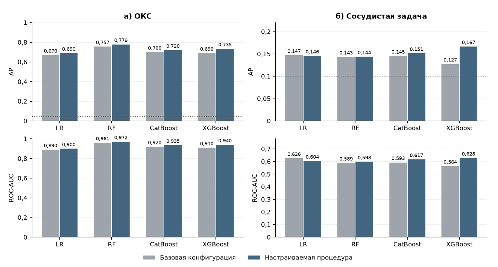
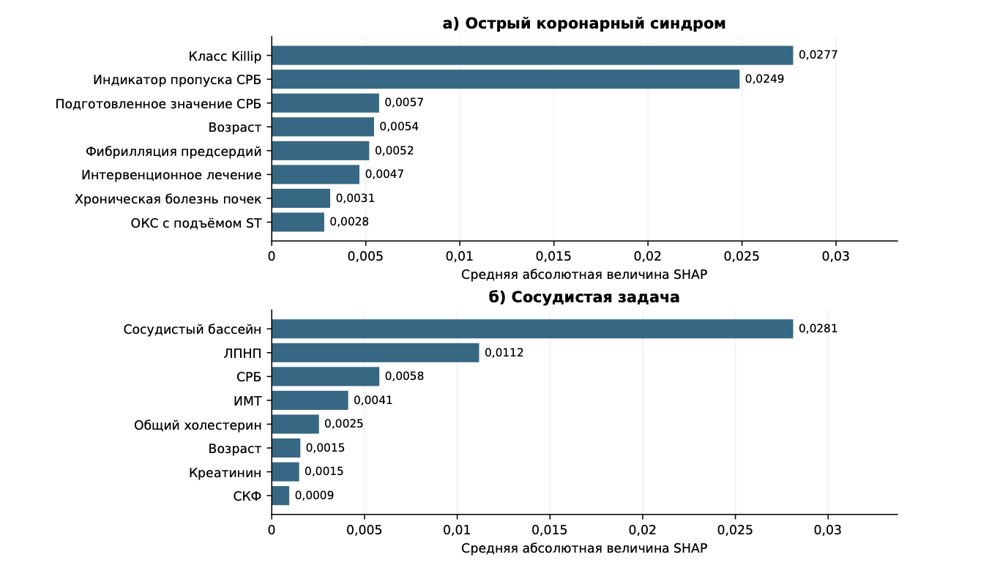
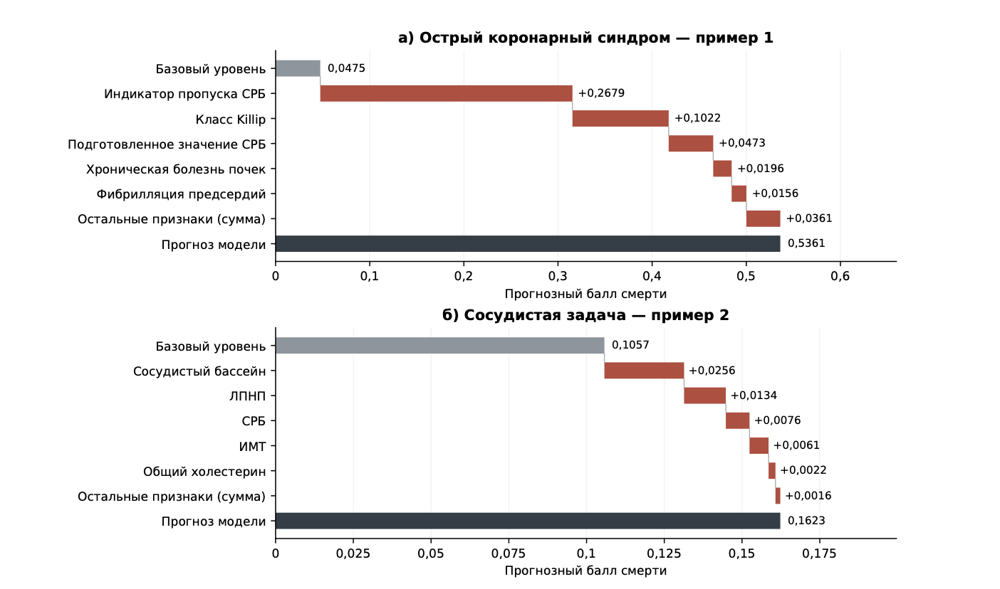

# Анализ важности признаков при неполных несбалансированных медицинских данных

Исследовательские материалы к одноимённой статье: обезличенные аналитические таблицы, код подготовки признаков, настройка и сравнение моделей, сохранённые прогнозы перекрёстной проверки и объяснения SHAP.

Работа подготовлена по результатам конференции **«Математика в медицине»** для представления в журнал [«Компьютерные исследования и моделирование»](https://crm.ics.org.ru/). Репозиторий сопровождает подготовку рукописи; наличие материалов здесь не означает принятия или публикации статьи. Библиографические данные опубликованной статьи и её DOI пока не заданы.

## Назначение и исследовательский вопрос

Рассматриваются две отдельные задачи бинарного прогнозирования летального исхода: острый коронарный синдром (ОКС) и сосудистая когорта. Основной вопрос — какие клинические характеристики и сведения об отсутствии измерений используются выбранными моделями при построении прогноза. Дополнительно исследуются влияние настройки гиперпараметров, сокращения большинства, весов классов и индикаторов пропусков, а также добавочная информация триглицеридов и метаболического синдрома в задаче ОКС.

Когорты не объединяются. Положительный класс `hospital_death = 1` обозначает зарегистрированный летальный исход, `0` — отсутствие соответствующей отметки смерти. В сосудистой задаче используются уточнённые автором исходы анкеты; ограничения этой разметки описаны ниже и в [описании данных](docs/DATA.md).

Это ретроспективное исследование. Модели и их объяснения не являются готовыми средствами клинического принятия решений. В частности, для ОКС время регистрации максимального ТАГ и части вмешательств не установлено; пригодность всех признаков для прогноза непосредственно при поступлении не подтверждена.

## Быстрая навигация

| Материал | Расположение |
|---|---|
| Данные ОКС: 906 записей, 43 отметки смерти | [data/acs.csv](data/acs.csv) |
| Данные сосудистой когорты: 548 записей, 55 отметок смерти | [data/vascular.csv](data/vascular.csv) |
| Словари признаков | [ОКС](data/acs_dictionary.csv), [сосудистая когорта](data/vascular_dictionary.csv) |
| Основные расчётные ноутбуки | [ОКС](notebooks/acs), [сосудистая когорта](notebooks/vascular) |
| Сохранённые расчётные результаты | [ОКС](results/acs), [сосудистая когорта](results/vascular) |
| Предварительные и исторические исследования | [notebooks/history](notebooks/history), [описание истории](docs/RESEARCH_HISTORY.md) |
| Инструкция по воспроизведению | [docs/REPRODUCIBILITY.md](docs/REPRODUCIBILITY.md) |
| Проверка сохранённых прогнозов и моделей | [scripts/verify_repository.py](scripts/verify_repository.py) |
| Происхождение файлов и изменения при экспорте | [манифест](docs/provenance/export_manifest.json) |
| Расхождения первого скриншота с расчётами | [docs/FIGURE_PROVENANCE.md](docs/FIGURE_PROVENANCE.md) |

## Данные и обезличивание

| Характеристика | ОКС | Сосудистая задача |
|---|---:|---:|
| Аналитические записи | 906 | 548 |
| Отметки смерти | 43 | 55 |
| Записи без отметки смерти | 863 | 493 |
| Доля положительного класса | 4,75% | 10,04% |
| Технические группы пациентов | 892 | 511 |
| Исходные предикторы | 15 | 14 |

По описанию рукописи клинические данные происходят из регистра Регионального сосудистого центра № 1, г. Новосибирск. Обновлённая разметка сосудистой когорты подготовлена по уточнённому источнику исходов; её нельзя складывать с прежней разметкой или считать независимой когортой.

В репозиторий включены реальные аналитические данные, а не синтетическая замена. Сохранены использованные численные и категориальные признаки, исходные пропуски и метки исхода. Таблицы не содержат ФИО, телефонов, адресов, дат рождения, номеров медицинских карт, свободных клинических описаний или таблицы соответствия пациентам. Поле `source_row`, связывавшее сосудистые записи со строками исходного файла, удалено. Группы перенумерованы в отдельные технические диапазоны для каждой когорты; одинаковые записи одного пациента остаются в одной группе. `row_id` — номер строки аналитической матрицы, а не идентификатор медицинской карты.

Исходные рабочие книги, анкеты и файлы с прямыми идентификаторами не включены. Выводы всех ноутбуков и лишние метаданные очищены. Сохранение группировки важно: без него повторные госпитализации могли бы одновременно попасть в обучение и проверку.

## Состав исследований

Для каждой когорты предусмотрены три основных ноутбука:

1. **`01_данные_и_подготовка.ipynb`** — проверка опубликованной аналитической матрицы, состава признаков, контрольных сумм, количества исходов и пропусков. Первичное сопоставление медицинских источников выполнено до экспорта; приватные источники для этого шага не требуются и не распространяются.
2. **`02_модели_Optuna_и_эксперименты.ipynb`** — логистическая регрессия, случайный лес, CatBoost и XGBoost; Optuna/TPE; вложенная проверка; выбор порога; контрольные модели; OOF-прогнозы; калибровка; bootstrap-интервалы; обучение окончательной модели. В ОКС включены контролируемые сравнения способов балансировки, индикаторов пропусков и вариантов набора ТАГ/МС. В сосудистой задаче сохранены ветви обучения на всех данных, отбора 10:1 и 5:1, а также оценки до и после поправки на отбор.
3. **`03_SHAP_и_итоги.ipynb`** — объяснение одной окончательной модели, глобальная важность признаков, зависимости вкладов и индивидуальные примеры. Для сосудистой задачи также сохранён анализ ошибок и результатов по сосудистым группам.

Отдельный скрипт [run_default_baseline.py](scripts/run_default_baseline.py) воспроизводит сравнение со стандартными параметрами библиотек в задаче ОКС. Эти базовые модели отличаются от более ранних вручную фиксированных конфигураций; соответствующие результаты не следует смешивать.

Основные снимки расчётов:

- ОКС: `oks_crp_indicator_restored_v3_2b854cfe4530` — индикатор отсутствия СРБ включён в те ветви, где предусмотрены индикаторы пропусков.
- Сосудистая задача: `hospital_updated55_v4_6e3c5bd8fdca` — уточнённая разметка с 55 отметками смерти.

## Дизайн проверки и обработка данных

Используются три внешних блока, три повторения разбиения и три внутренних блока. Все записи одной технической группы пациента удерживаются в одной части разбиения. Внешние исходы не участвуют в настройке гиперпараметров или выборе порога. Основной критерий настройки — средняя AP внутренних блоков; при близких значениях учитывается оценка Брайера. Порог выбирается по внутренним OOF-прогнозам через максимизацию сбалансированной точности, при равенстве предпочтительна большая чувствительность.

Численные пропуски заполняются медианой, категориальные — модой. Вариант с индикаторами вычисляет признак отсутствия значения до импутации. В ОКС параметры преобразований оцениваются по внешней/внутренней обучающей части до сокращения большинства; в сосудистой задаче — по оставленной обучающей подвыборке. Проверочные блоки сохраняют исходное соотношение классов.

В ОКС сравниваются все реальные обучающие записи, веса классов и стратифицированный отбор выживших 4:1; случайный отбор 4:1 является дополнительным контролем. Для стратификации используются возраст и Killip. В сосудистой задаче рассматриваются отношения выживших к умершим 10:1 и 5:1 со стратификацией по сосудистой группе и возрасту; все положительные исходы сохраняются. На полной сосудистой когорте 10:1 фактически сохраняет все записи, а 5:1 — 330 записей, включая 55 положительных. SMOTE относится к историческим экспериментам и не используется в основном протоколе этих двух актуальных запусков.

В сосудистой задаче после отбора применяется поправка `p = r * p_raw / (1 - p_raw + r * p_raw)`, где `r` — доля оставленных отрицательных наблюдений соответствующей обучающей страты. Она не является гарантией полной калибровки. SHAP объясняет уже исправленный выход полного алгоритма.

Метрики усредняются двумя разными способами: по девяти внешним блокам и по трём полным OOF-наборам. Для AP и ROC-AUC эти величины в общем случае различаются. Bootstrap-интервалы по фиксированным OOF-прогнозам не учитывают повторную настройку моделей и являются условными.

## Результаты расчётов и присланные иллюстрации

### 1. Сравнение моделей



| Модель | AP без настройки, стандартные параметры | AP после настройки | ROC-AUC без настройки | ROC-AUC после настройки |
|---|---:|---:|---:|---:|
| LR | 0,7405 | 0,7119 | 0,9485 | 0,9455 |
| RF | 0,7567 | 0,7788 | 0,9607 | 0,9716 |
| CatBoost | 0,7840 | 0,7604 | 0,9707 | 0,9638 |
| XGBoost | 0,7303 | 0,7699 | 0,9534 | 0,9628 |

Пунктир обозначает базовый AP постоянного прогноза, одинакового для всех пациентов. Внутри одного проверочного блока AP такого прогноза равен доле положительного класса в этом блоке, даже если само постоянное значение оценено по обучающей частоте смерти. Для графика со средними метриками используется среднее соответствующих блоковых уровней.

### 2. Глобальная важность признаков



В ОКС объясняется окончательный RF с 600 деревьями и глубиной не более 4, обученный на всех 906 записях. Используется Tree SHAP с `tree_path_dependent`; преобразованные столбцы категориального признака суммируются, а индикаторы пропусков представлены отдельно. Ведущими компонентами являются Killip и индикатор пропуска СРБ. Суммирование столбцов — способ представления объяснения, а не отдельный расчёт значений Шэпли для игры с объединёнными признаками.

В сосудистой задаче объясняется XGBoost с 400 деревьями, глубиной не более 3 и отбором 5:1. Permutation SHAP применяется к полному алгоритму, включая импутацию и поправку на отбор. Используются 14 исходных признаков, фон из 50 реальных записей и бюджет 290 оценок. Наибольшие средние абсолютные вклады связаны с сосудистой группой и ЛПНП.

Ранжирование отражает использование признаков конкретными моделями, а не причинное влияние на смерть. Величины SHAP между задачами нельзя напрямую сопоставлять: различаются модели, фоновое распределение и состав объясняемых компонентов.

### 3. Индивидуальные объяснения



Иллюстрируются две записи с положительным исходом: пример ОКС с прогнозом около 0,5361 и сосудистый пример с прогнозом около 0,1623. Это примеры объяснения окончательных моделей на полной когорте, а не независимые проверочные прогнозы выбранных пациентов. Исходные значения вкладов для рисунка находятся в [local_examples.json](docs/provenance/local_examples.json). Округление подписей может давать небольшое расхождение суммы с итогом; для проверки используется полный массив SHAP с допуском `1e-5`.

## Как воспроизвести

Рекомендуется Python 3.11. Зафиксированные версии научных библиотек приведены в [requirements.txt](requirements.txt). Они взяты из реально использованной среды, а не подобраны приблизительно.

```bash
python3.11 -m venv .venv
source .venv/bin/activate
python -m pip install -r requirements.txt
python -m ipykernel install --prefix .venv --name clinical-mortality-shap --display-name "Clinical mortality SHAP"
python scripts/verify_repository.py --output runs/recorded_results_check.json
python scripts/run_notebooks.py --cohort acs --stage data --kernel clinical-mortality-shap
python scripts/run_notebooks.py --cohort vascular --stage data --kernel clinical-mortality-shap
```

На Windows активация среды выполняется через `.venv\Scripts\activate`. Для работы в Jupyter выбирается ядро установленной среды.

Для полного перерасчёта:

```bash
python scripts/run_notebooks.py --cohort acs --stage all --kernel clinical-mortality-shap
python scripts/run_notebooks.py --cohort vascular --stage all --kernel clinical-mortality-shap
python scripts/run_default_baseline.py
```

Полный запуск включает тысячи испытаний Optuna и множество обучений; это существенно дольше проверки сохранённых результатов. Все новые результаты записываются в `runs/`, который исключён из Git. При первом запуске туда копируются опубликованные данные и сохранённые артефакты. Можно отдельно выполнить `--stage shap` для объяснения сохранённой модели без нового поиска. После нового запуска стадии `models` для согласованного объяснения нужно повторить стадию `shap`.

Заново выполненный поиск получает собственный RUN_ID из данных, кода и конфигурации. Изменения версий, платформы и порядка вычислений могут изменить результат поиска. Публикуемые OOF-прогнозы и разбиения позволяют независимо проверить зафиксированные метрики без повторения всего поиска. SQLite-кеши исходных локальных запусков не включены; подробные таблицы испытаний сохранены, а новые базы создаются при перерасчёте.

## Проверки, ограничения и цитирование

Проверяющий скрипт заново вычисляет метрики из OOF-прогнозов, проверяет соответствие исходам, покрытие записей, групповое разделение, аддитивность SHAP и прогноз повторно загруженной модели. Машиночитаемый отчёт подготовки — [verification/recorded_results_check.json](verification/recorded_results_check.json). Полный поиск Optuna не повторялся при упаковке репозитория; это не новая внешняя валидация. Проверка переносимых ноутбуков описана в [REPRODUCIBILITY.md](docs/REPRODUCIBILITY.md).

Ограничения исследования: малое число событий, возможные ошибки группировки одноимённых пациентов, повторные отметки смерти в сосудистых записях, неоднозначность части первичных кодировок, высокая неполнота ряда признаков, неизвестное время регистрации части данных и отсутствие независимой клинической внешней проверки. Улучшение AP не гарантирует улучшения калибровки или клинической полезности.

Ссылка на код для рукописи:

```latex
Код вычислительных экспериментов и обезличенные аналитические данные
доступны в репозитории:
\url{https://github.com/NikitaDzigurda/clinical-mortality-shap}.
```

Формат цитирования и основные методические источники приведены в [docs/CITATION.md](docs/CITATION.md). Репозиторий не присваивает авторам или владельцам клинических данных неустановленные лицензии. Условия повторного использования должны определяться правообладателями отдельно.
